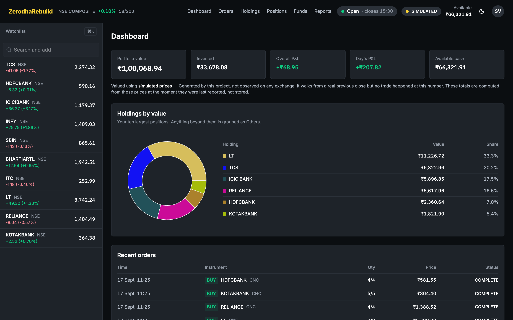
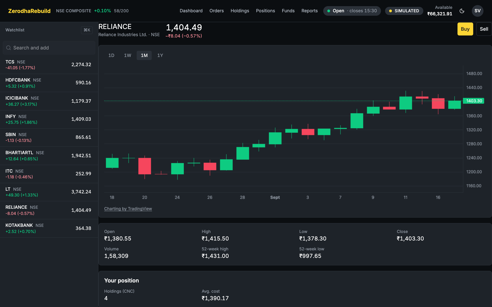
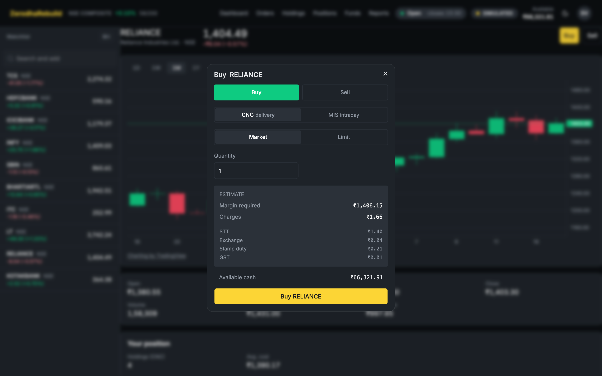
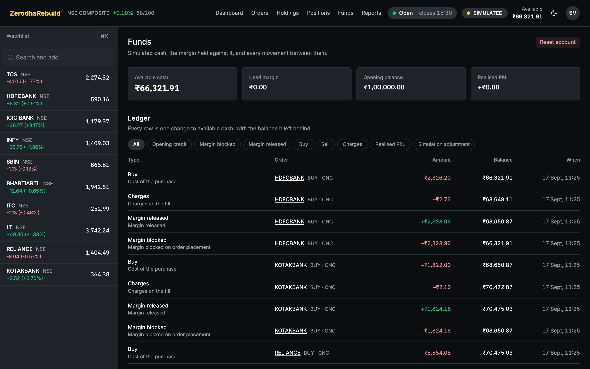
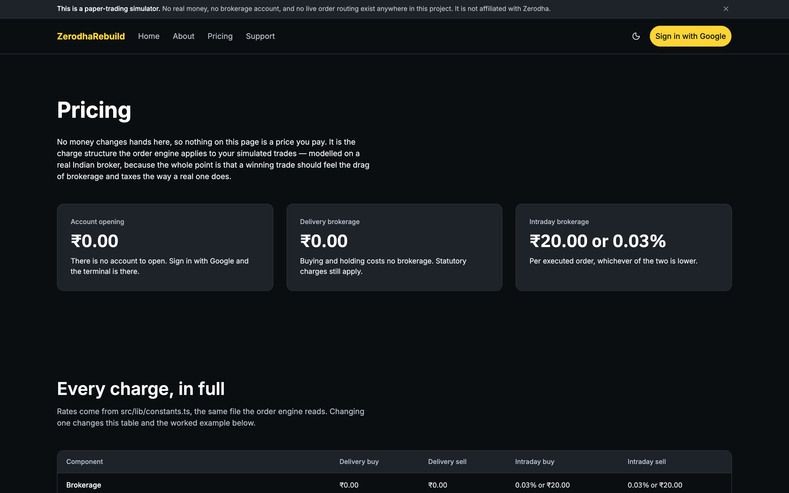
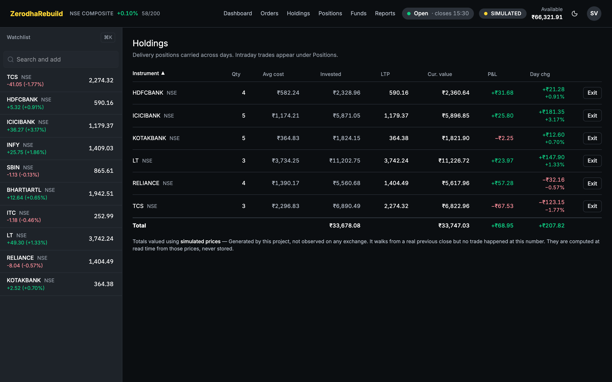
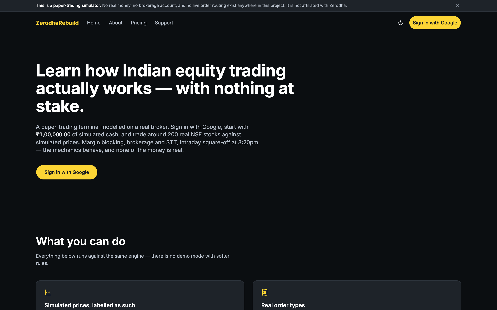
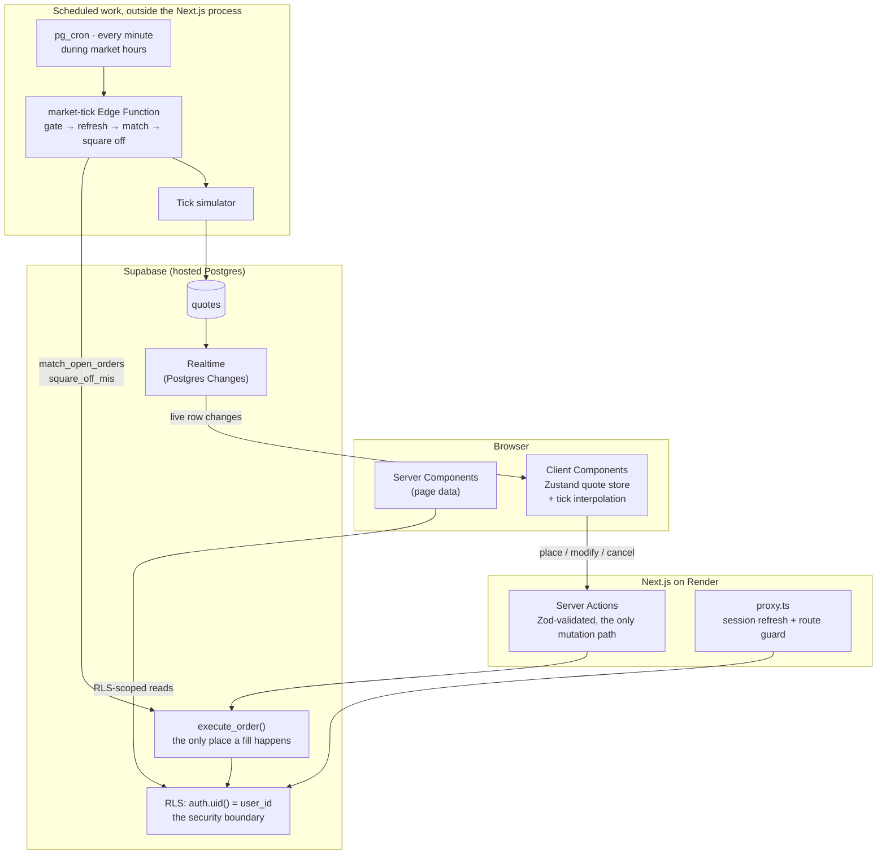

<div align="center">

# ZerodhaRebuild

Practise trading NSE stocks with ₹1,00,000 of simulated cash.

A paper-trading platform modelled on Zerodha's Kite terminal. It simulates order execution,
trading charges, and margin: the cash set aside to cover an order or an open short position.
Every cash movement is recorded in a ledger so the account balance can be checked.

[](https://nextjs.org)
[](https://www.typescriptlang.org)
[](https://supabase.com)
[](#testing)
[](context/architecture.md#quote-provenance)
[](LICENSE)

**[Live demo](https://zerodha-rebuild.onrender.com)** ·
**[Portfolio](https://siddarthvaidya2005-7iyf.onrender.com/)** ·
**[LinkedIn](https://www.linkedin.com/in/siddarth-vaidya-885871239)**



</div>

> [!NOTE]
> An independent portfolio project, **not affiliated with or endorsed by Zerodha Broking Ltd.**
> No real money moves anywhere in the system, and all prices are simulated.

## Contents

[Highlights](#highlights) · [Screenshots](#screenshots) · [Features](#features) ·
[Tech stack](#tech-stack) · [How it works](#how-it-works) · [Architecture](#architecture) ·
[Testing](#testing) · [Challenges and lessons](#challenges-and-lessons) ·
[Getting started](#getting-started) · [Scope and limitations](#scope-and-limitations) ·
[Roadmap](#roadmap) · [Author](#author)

---

## Highlights

- Each order fill runs inside one Postgres function, `execute_order`. The cash, trade, portfolio,
  and ledger changes either succeed together or are all rolled back. This is an atomic transaction.
- Postgres calculates stored balances, average prices, charges, and profit or loss (P&L) using exact
  decimal arithmetic. TypeScript displays the results and provides clearly labelled charge estimates.
- Row Level Security (RLS) keeps each user's account data private in the database. Client roles can
  read their money tables; approved database functions perform the writes.
- Order execution follows a tested locking protocol: `orders` → `funds` → `holdings`/`positions`.
  Internal helpers rely on the caller already holding the required locks; tests check those rules.
- Four test tiers cover logic, database rules, concurrent requests, and agreement between the
  TypeScript charge estimator and Postgres calculator.
- Every displayed price exposes its source. Simulated prices are always labelled as simulated.

---

## Screenshots

|                                                                                                                                         |                                                                                                                         |
| --------------------------------------------------------------------------------------------------------------------------------------- | ----------------------------------------------------------------------------------------------------------------------- |
| **Stock detail**: candlesticks, open/high/low/close prices, and a buy/sell ticket<br> | **Order ticket**: required margin, based on the existing position<br> |
| **Funds**: every rupee that moved, as a ledger<br>                                                  | **Pricing**: the charge model the engine applies<br>                            |
| **Holdings**: P&L and day change from simulated prices<br>                                    | **Landing page**: the public marketing site<br>                               |

---

## Features

| Area          | What you get                                                                                                                                                                                                                         |
| ------------- | ------------------------------------------------------------------------------------------------------------------------------------------------------------------------------------------------------------------------------------ |
| **Orders**    | Market orders fill at the observed price; limit orders wait for a qualifying price. CNC is delivery trading; MIS is intraday trading. Open limit orders can be modified or cancelled.                                                |
| **Risk**      | Orders reserve cash where required. Cancellation or rejection releases it. A fill opening a short transfers the required collateral to the position until it is covered. Remaining MIS positions close automatically from 15:20 IST. |
| **Charges**   | A documented model for brokerage, Securities Transaction Tax (STT), exchange and SEBI fees, stamp duty, Goods and Services Tax (GST), and depository participant (DP) charges.                                                       |
| **Portfolio** | Holdings, Positions, Funds, and Reports. View completed-trade P&L, changes in open positions, and a ledger of every cash movement.                                                                                                   |
| **Terminal**  | Search and reorder the watchlist, inspect candlestick charts, and reset the trading account to ₹1,00,000.                                                                                                                            |
| **Quality**   | Light and dark themes, layouts down to 375px, public-page Lighthouse audits, and signed-in terminal checks with axe.                                                                                                                 |

Full scope and a short glossary: [`context/project-overview.md`](context/project-overview.md).

---

## Tech stack

| Layer                       | Technology                                                                                                         |
| --------------------------- | ------------------------------------------------------------------------------------------------------------------ |
| **Frontend**                | Next.js 16 (App Router, Server Components) · React 19 · TypeScript (strict) · Tailwind CSS v4 · shadcn/ui on Radix |
| **Client state and charts** | Zustand · Lightweight Charts · Recharts                                                                            |
| **Backend and data**        | Supabase Postgres · plpgsql functions · Row Level Security · Zod-validated Server Actions                          |
| **Auth**                    | Supabase Auth with Google OAuth                                                                                    |
| **Realtime and jobs**       | Supabase Realtime · Edge Functions (Deno) · `pg_cron`                                                              |
| **Testing**                 | Vitest · pgTAP · node-postgres                                                                                     |
| **Hosting**                 | Render · hosted Supabase                                                                                           |

Pinned versions live in [`package.json`](package.json). Full stack rationale:
[`context/architecture.md`](context/architecture.md#stack).

---

## How it works

1. Sign in with Google. On first sign-in, a database trigger creates the account, credits ₹1,00,000,
   records the credit in the ledger, and adds a starter watchlist.
2. A scheduled job calls the `market-tick` Edge Function every minute during NSE hours. The simulator
   generates prices from recorded NSE closing prices, then Supabase Realtime sends updates to browsers.
   The watchlist animates intermediate prices for smoother movement; trading uses the server price.
3. Submit an order. A Server Action validates the input and calls the database to reserve margin
   where required. Market orders attempt an immediate fill during a session. Limit orders wait until
   an observed price reaches or improves on the limit.
4. Postgres processes the fill in one transaction, including charges and ledger entries.
5. The first market tick at or after 15:20 IST closes remaining MIS positions and records their P&L.

> [!IMPORTANT]
> **Prices are simulated.** The roughly 200 instruments are real Nifty 200 constituents, but this
> build has no external quote provider. Prices are generated from recorded NSE closing prices.
> Each quote stores its provider and timestamp; the UI uses those fields to determine its source label.
> Details:
> [`context/architecture.md` → Quote Provenance](context/architecture.md#quote-provenance).

---

## Architecture



Render's free web service sleeps after 15 minutes without traffic. Scheduling the job in Supabase
lets prices refresh, limit orders match, and intraday positions close while the web service sleeps.

| Go deeper                                    | Document                                                                   |
| -------------------------------------------- | -------------------------------------------------------------------------- |
| System boundaries, auth and the invariants   | [`context/architecture.md`](context/architecture.md#invariants)            |
| Tables, views and folder structure           | [`context/architecture/data-model.md`](context/architecture/data-model.md) |
| Charges, margin, ledger and P&L rules        | [`context/trading-contract.md`](context/trading-contract.md)               |
| Server Action and Postgres function patterns | [`context/architecture/patterns.md`](context/architecture/patterns.md)     |
| Code standards                               | [`context/code-standards.md`](context/code-standards.md)                   |

---

## Testing

| Tier               | Tool          | What it proves                                                         | Command            |
| ------------------ | ------------- | ---------------------------------------------------------------------- | ------------------ |
| **1. Logic**       | Vitest        | Charge estimator, market hours, parsers, provider chain                | `pnpm test`        |
| **2. Database**    | pgTAP         | RLS, grants, CHECK constraints, function correctness, lock order       | `pnpm test:db`     |
| **3. Concurrency** | node-postgres | Row-lock races across two live connections                             | `pnpm test:race`   |
| **4. Parity**      | node-postgres | The TypeScript charge estimate equals the Postgres calculation exactly | `pnpm test:parity` |

Tier 3 commits data to the project's one hosted database and requires `ALLOW_RACE_TESTS`. Tiers 2–4
require `TEST_DATABASE_URL`; the parity suite is read-only. Read
[`context/code-standards/testing.md`](context/code-standards/testing.md) before running database tests.

---

## Challenges and lessons

- Provider checks during development found no usable free NSE source: Twelve Data's free plan did
  not include NSE symbols, and Yahoo blocked the development IP. The project therefore uses the
  simulator for all quotes and makes that source visible beside prices.
- Fills, cancellation, limit matching, and square-off can touch the same account simultaneously.
  Execution paths use `orders` → `funds` → `holdings`/`positions`, with explicit preconditions for
  internal helpers. A database test catches changes to that protocol. The phase plans retain the
  unresolved cross-user sweep follow-ups.
- `supabase test db` required Docker even for the hosted database. A small custom runner executes
  the pgTAP suites directly instead.
- Leftover local auth cookies caused blank pages by exceeding Node's 16 KB request-header limit.
  These HTTP 431 requests failed before Next.js could log them.

Design notes and past decisions: [`context/constraints.md`](context/constraints.md).

---

## Getting started

**Prerequisites:** Node 26, pnpm 11 and a Supabase project. Docker is not needed.

```bash
git clone https://github.com/SidVaidya2005/ZerodhaRebuild.git
cd ZerodhaRebuild
pnpm install
cp .env.example .env.local   # fill in your Supabase values
pnpm supabase link --project-ref <your-project-ref>
pnpm supabase db push
pnpm seed
pnpm dev                     # http://localhost:3000
```

Google OAuth, environment variables, the scheduled job, every command and deployment are covered in
**[`docs/SETUP.md`](docs/SETUP.md)**.

---

## Scope and limitations

**Deliberately out of scope:** real money or brokerage integration, derivatives, SL/GTT/AMO and
bracket orders, mutual funds and IPOs, KYC, and CNC short selling. The full list is in
[`context/project-overview.md`](context/project-overview.md#features-out-of-scope).

**Known simplifications** (also disclosed on `/legal` in the app):

- DP charges apply per sell order rather than per scrip per day.
- Fills are all-or-nothing; there are no partial fills.
- A short cover always closes. Its cash debit is capped by collateral plus available cash; any
  uncovered amount is recorded as a simulation adjustment. Reports retain the full loss.
- Day's P&L measures every holding against the previous close, including shares bought today.

The rules behind each one are in [`context/trading-contract.md`](context/trading-contract.md).
Account reset clears the trading history and restores the opening balance; it keeps profile and
watchlist preferences.

---

## Roadmap

These are possible future extensions, outside the current build scope. Their presence here does
not change the simulator-only data decision or authorise feature work.

- [ ] Plug in a real delayed NSE data provider; the provenance model already supports it
- [ ] Stop-loss and GTT orders
- [ ] Partial fills against a simulated order book
- [ ] DP charges per scrip per day, matching real brokers
- [ ] Corporate actions such as splits and dividends

---

## Author

Built by **Siddarth Vaidya**.

[](https://siddarthvaidya2005-7iyf.onrender.com/)
[](https://www.linkedin.com/in/siddarth-vaidya-885871239)
[](https://github.com/SidVaidya2005)
[](mailto:siddarthvaidya2005@gmail.com)

## License

[MIT](LICENSE)
